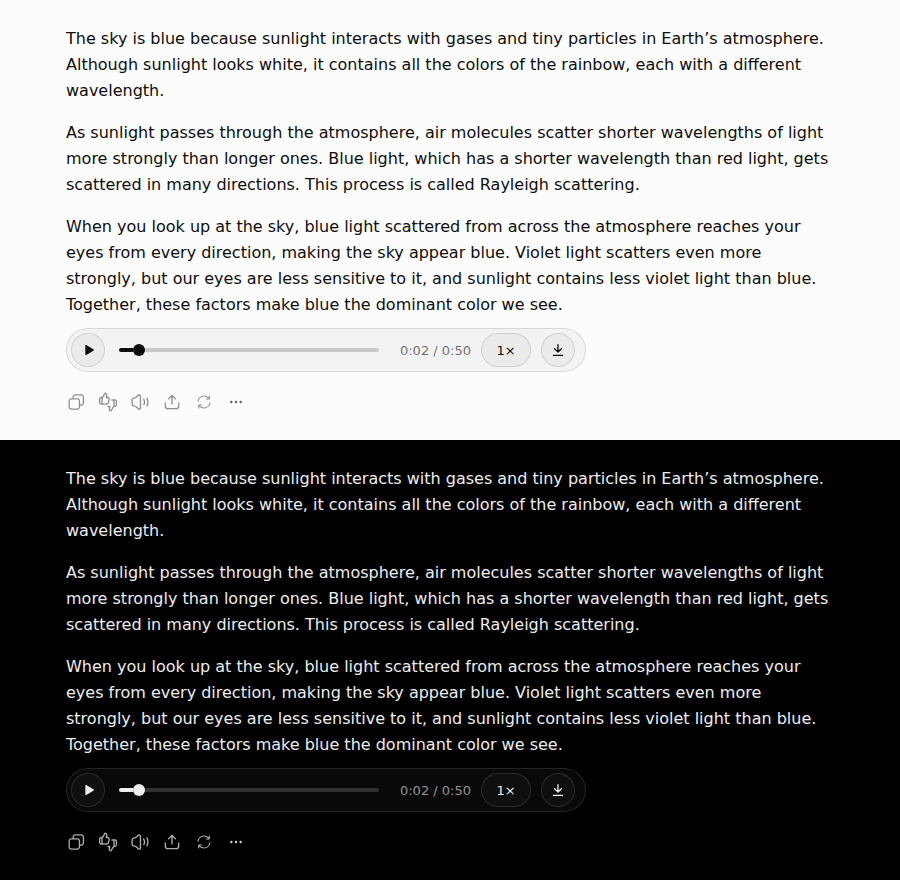

# ChatGPT Voice Player

A Chrome extension that puts a real audio player under every ChatGPT reply on
[chatgpt.com](https://chatgpt.com): play, **pause**, seek, change speed, download.

ChatGPT's own **Read aloud** can only start and stop: no pause, no seeking, no speed control, and it
makes you wait while the audio is generated. This extension voices each finished reply in advance, so
the player is ready by the time you finish reading.



## Features

- A player under each finished assistant reply: play / pause, seek bar, elapsed and total time.
- Speed: 1×, 1.25×, 1.5×, 1.75×, 2× — one setting for all replies, remembered.
- Audio is fetched as soon as a reply is finished, without a click. Replies far up a long
  conversation are fetched when you scroll near them, two at a time.
- ChatGPT's own **Read aloud** button plays and pauses the player of its reply.
- Starting one reply pauses any other. Media keys (play/pause, ±10 s) work.
- Download the reply as MP3.
- The voice is the one picked in ChatGPT settings; the popup can override it (Sol, Arbor, Spruce,
  Breeze, Cove, Ember, Juniper, Maple, Vale).
- Follows ChatGPT's light and dark themes.

## Install

The extension is not in the Chrome Web Store; load it unpacked:

1. Download `chatgpt-voice-player.zip` from the
   [latest release](https://github.com/iliyasone/chatgpt-voice-player/releases/latest) and unzip it
   (or clone this repository).
2. Open `chrome://extensions` and turn on **Developer mode** (top right).
3. Click **Load unpacked** and pick the unzipped folder (the one with `manifest.json`; in a clone it
   is `extension/`).
4. Reload any open chatgpt.com tab.

Works in Chrome, Edge, Brave, Arc and other Chromium browsers.

## Settings

Click the extension icon:

- **Voice** — *Same as in ChatGPT* uses the voice from ChatGPT's settings; any other choice
  overrides it for this extension only.
- **Speed** — the default playback speed (the `1×` button on a player changes the same setting).
- **Load audio in advance** — on by default. Off: a reply is voiced on the first click of Play.

## How it works

A content script on chatgpt.com finds finished assistant replies and calls the same endpoint
ChatGPT's Read Aloud uses:

```
GET /backend-api/synthesize?message_id=<id>&conversation_id=<id>&voice=<voice>&format=mp3
```

with the access token from `/api/auth/session` of your own signed-in session. The MP3 is kept in
memory as a blob for the life of the tab. Nothing is sent anywhere except chatgpt.com, and the
extension stores only its own three settings (see [PRIVACY.md](PRIVACY.md)).

Each synthesize call counts against your ChatGPT usage the same way clicking Read aloud does. Turn
off **Load audio in advance** if you rarely listen.

ChatGPT changes its markup often. The selectors live at the top of the "page scanning" section of
[`extension/content.js`](extension/content.js); when the players stop appearing, that is the place
to look.

## Development

```sh
git clone https://github.com/iliyasone/chatgpt-voice-player
# chrome://extensions → Load unpacked → extension/
# after editing: click ↻ on the extension card, then reload chatgpt.com
./scripts/package.sh   # builds dist/chatgpt-voice-player.zip for a release or the Web Store
```

No build step and no dependencies: plain Manifest V3 JavaScript and CSS.

## License

[MIT](LICENSE)
